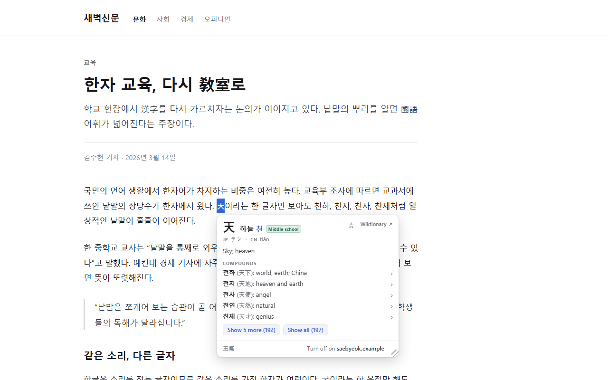
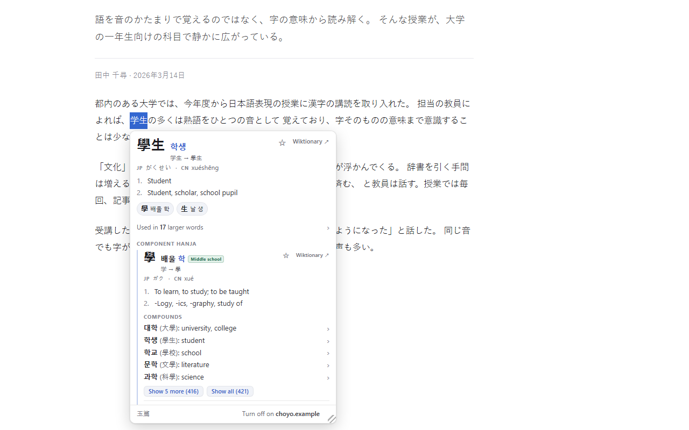
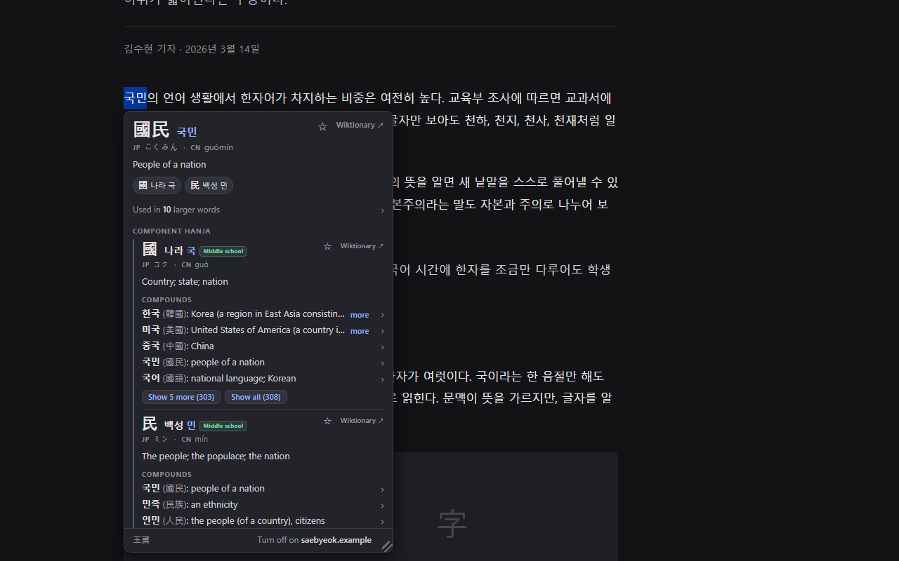
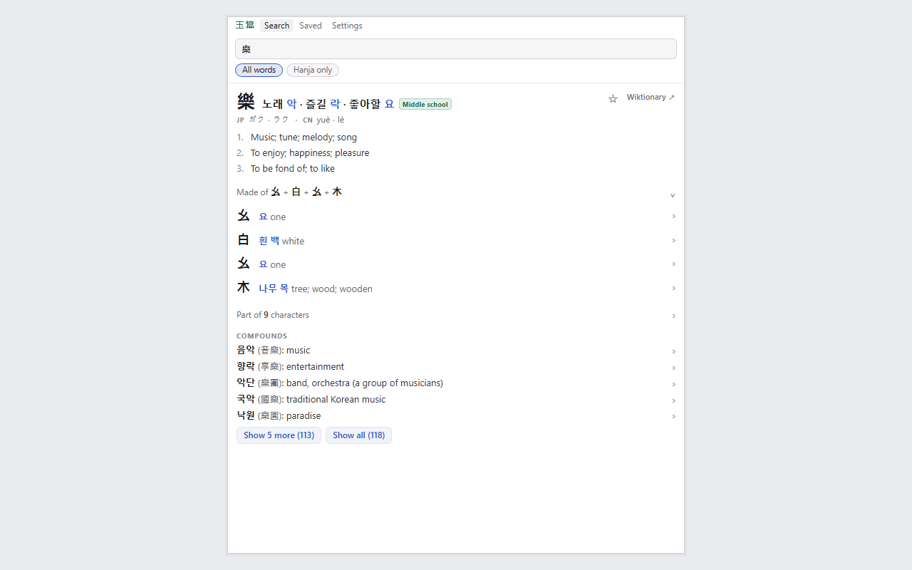
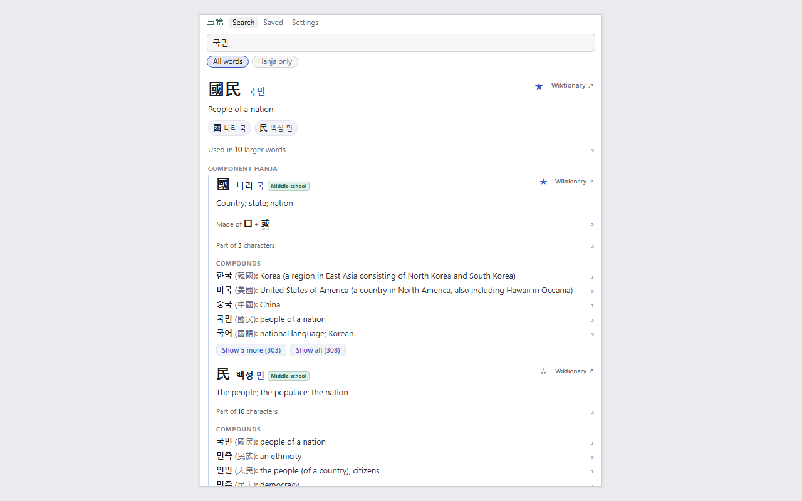
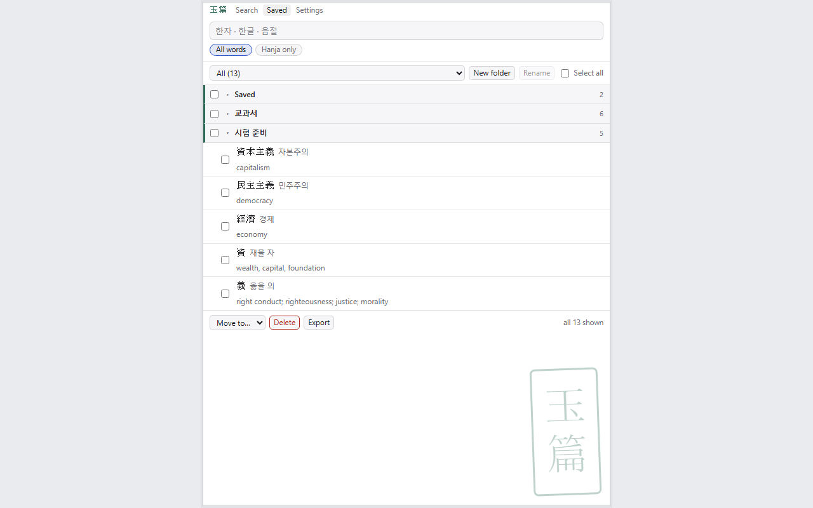

# Okpyeon: Korean Hanja Popup Dictionary

A study tool for Korean learners. Highlight hanja, hanzi, or kanji on any page
to read them in Korean, or highlight a hangul word to see its hanja. The
toolbar button opens a sidebar with typed search, saved words, and settings;
typing `hj` in the address bar searches from anywhere.

옥편 (玉篇) is the traditional Korean word for a hanja dictionary.



## What it does

- **Characters into Korean.** Select a hanja to see its eumhun (나라 국 for
  國), readings, English definitions, and common compounds. Simplified Chinese
  and Japanese shinjitai forms resolve to the same entries, so those pages
  work too.
- **Korean words into hanja.** Highlight a Sino-Korean word in hangul (국민)
  to see its hanja (國民), meaning, and component characters.
- **Word breakdown.** Compounds split into component words (자본주의 → 資本 +
  主義). Everything is clickable, and a breadcrumb trail returns to any
  earlier step.
- **Character breakdown.** A character's card shows what it is made of
  (樂 = 幺 + 白 + 幺 + 木), each part clickable with its own reading,
  and which other characters use it as a part. The part that gives a
  character its sound is marked: in 請 (청), that part is 靑 (청).
- **Browse by sound.** Highlight a single syllable (국) to list every hanja
  read that way. Readings on cards are links too: a character's eum opens its
  homophone list, and a word's hangul shows its other spellings.
- **Character levels.** Each character is marked Middle school, High school,
  Advanced, or Rare. The school levels follow the Ministry of Education
  curriculum; Advanced and Rare are Okpyeon's own classification.
- **No Korean keyboard needed.** Typing `toddlf` (the 2-set layout on an
  English keyboard) finds 생일, and typing `gungmin` or `gukmin`
  (romanization) finds 국민. A query that could be read both ways shows
  both.
- **Saved words.** The star on any card saves the entry into a folder; the
  Saved view manages folders with batch move and delete.
- **Recent lookups.** The empty sidebar lists the last few entries you
  looked up, on a page or in the search box. They stay on your computer, and
  Settings turns the list off or clears it.
- **Off on a site.** The line at the bottom of the popup turns it off on that
  site. Settings lists those sites and turns them back on.
- **Export.** Saved words export as an Anki text file or as CSV. Settings
  picks the Anki card fields and the default folder, and folder names become
  Anki tags.
- **Wiktionary links.** Every card links to its Wiktionary entry.
- **Native words.** Native Korean words show nothing rather than a forced
  match. A native word that shares its sound with an obscure hanja spelling
  (사랑 and 舍廊) is labelled a rare homograph, not the word's origin.
- **Native Korean words.** Native words get their own cards and an All
  words search scope, making Okpyeon a dictionary of all Korean. A
  conjugated form opens its dictionary form: 먹었어 is a form of 먹다,
  and 할거야 of 하다. One setting turns native words off.
- **Japanese and Chinese readings (optional).** Two settings add each
  character's on'yomi and pinyin beside its Korean reading: 學 is 학 in
  Korean, ガク in Japanese, xué in Mandarin.
- **Korean language mode.** One setting switches the whole extension
  into Korean: menus, labels, and definitions. The definitions come from
  우리말샘, the open dictionary of the National Institute of Korean
  Language, and each card links to its 우리말샘 entry. If Chrome is set
  to Korean, the extension starts in Korean.
- **Private and offline.** The whole dictionary ships inside the extension.
  It makes no network requests and collects no data. Saved words stay on your
  device. See [privacy-policy.html](privacy-policy.html).



*学生 selected on a Japanese page, resolving to 學生.*



*Reverse lookup in dark mode: 국민 back to 國民.*



*樂 split into its parts, each with a reading.*



*The sidebar's search view.*


*The same view in Korean language mode, with 우리말샘 definitions.*



*Saved words in folders.*

## Install

From the [Chrome Web Store](https://chromewebstore.google.com/detail/enjmfjcemaiabocebnfokcmglfmnfjhl).

From source: clone this repo, open `chrome://extensions`, enable Developer
mode, and use **Load unpacked** on the `extension/` folder. The dictionary
data is committed, so no build step is needed just to run it.

Firefox (140 or later): `python pipeline/make_firefox.py` writes the Firefox
package to `dist/firefox/` and `okpyeon-firefox-<version>.zip`. To try it,
run `npx web-ext run --source-dir dist/firefox`, or load
`dist/firefox/manifest.json` from `about:debugging` as a temporary add-on.
The source tree is shared; only the manifest differs (see `SPEC.md`,
"Firefox and the English name").

## Repository layout

```
extension/     the extension itself (MV3); data/ holds the built dictionary
pipeline/      build tooling: dictionary build, icons, promo tiles, store zip
test/          Node unit tests for the lookup logic
test-page/     standalone browser test page with self-checks (no build needed)
screenshots/   store listing assets
SPEC.md        the internal spec the implementation follows
```

## Building the dictionary

```
python pipeline/build.py
```

Downloads the source corpora into `pipeline/cache/` on first run (~1.8 GB:
kaikki.org Wiktionary extracts for Korean/Translingual/Japanese/Chinese, Unicode
Unihan, a subtitle-derived frequency list, and the 우리말샘 XML, which is
preprocessed once into a small intermediate file), then builds
`extension/data/*.json` from a warm cache and verifies the output against a
set of anchor entries. See `pipeline/README.md` for details.

Tests:

```
node test/lookup.test.mjs
node test/deconjugate.test.mjs
node test/firefox.test.mjs
```

UI self-checks, headless:

```
python pipeline/run_selfchecks.py
```

Or serve the repo (`python -m http.server` from the repo root), open
`http://localhost:8000/test-page/index.html`, and press "Run self-checks". The
pages answer through the real lookup modules, which browsers will not load from
`file://`.

## Licenses

- **Code**: [GPL-3.0](LICENSE).
- **Dictionary data** (`extension/data/*.json`): CC BY-SA, derived from
  English Wiktionary (via kaikki.org), 우리말샘 (National Institute of Korean
  Language, CC BY-SA 2.0 KR), the Unicode Unihan database, the jōyō kanji
  table via Wikipedia, and the Korean Wikipedia curriculum table. See
  [extension/data/DATA-LICENSE.md](extension/data/DATA-LICENSE.md) for full
  attribution.
